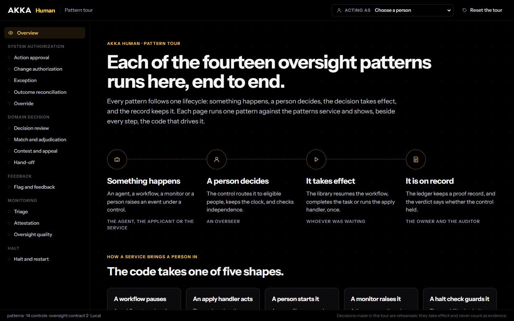
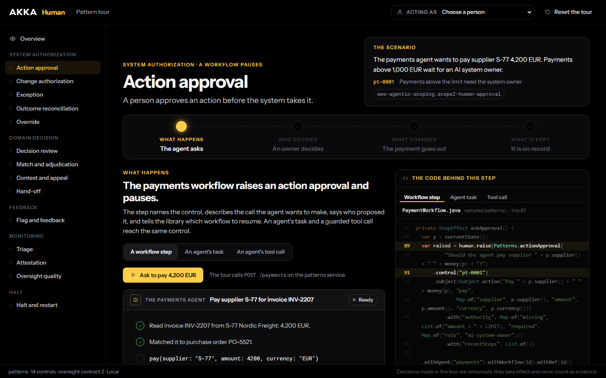
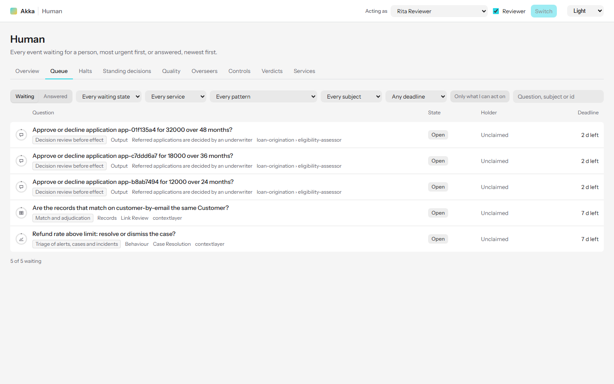
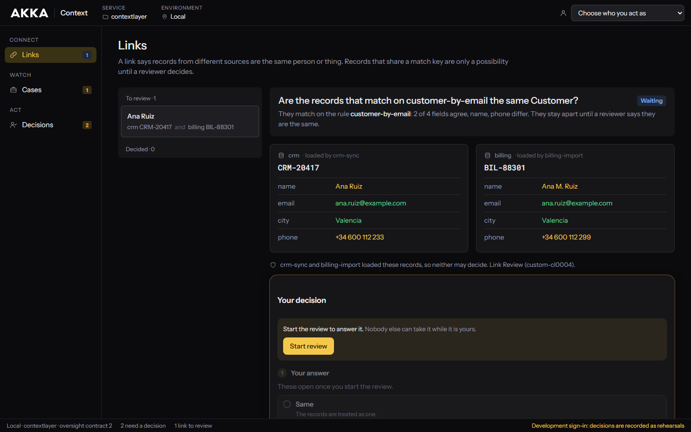
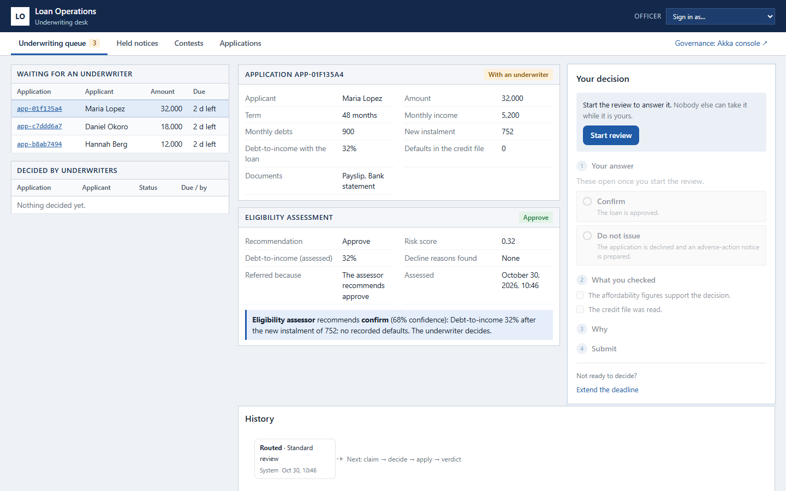
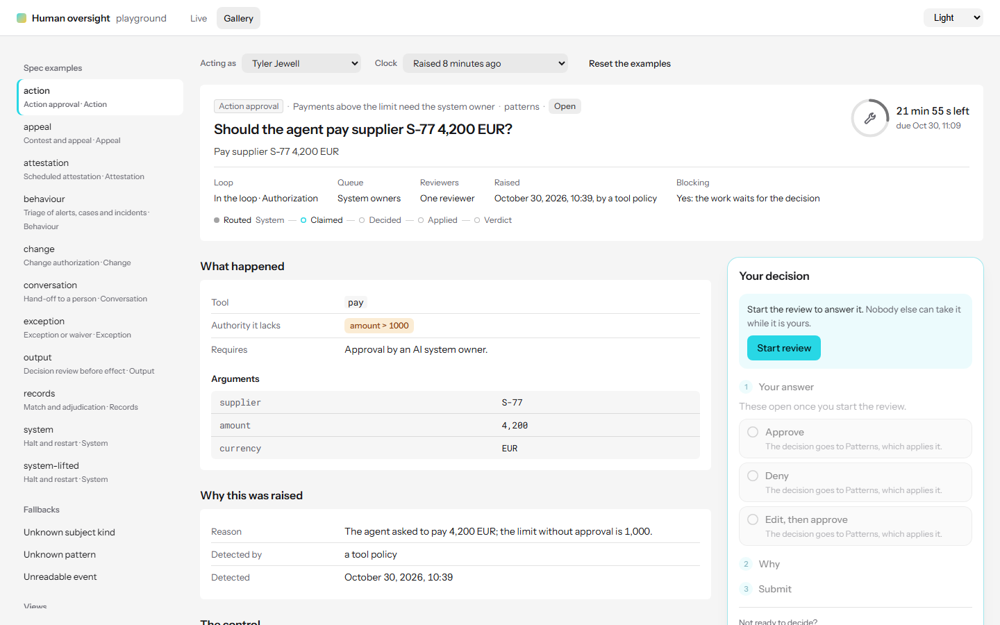

# human

Human oversight for Akka services. A service sometimes has to stop and let a person decide: approve
a payment, review a letter before it goes to a customer, authorise a model change, hear an appeal,
take over a conversation, halt a system. These situations come down to fourteen recurring patterns.
This repository gives a service one engine for all of them, one HTTP contract that every console
reads, and console components that can show any of them.

Everything runs locally, end to end. Three sample services use the library. A companion merges their
events into a single API, and there are four consoles for working through those events.



**Status: a working prototype, version 0.1.0-SNAPSHOT.** Some behaviour the library needs is
missing from the Akka SDK and runtime. That behaviour is built here as stand-ins, behind the
interfaces the real versions would have ([Repository](docs/05-repository.md)).

## The demos

| Port | Demo | Who it is for |
|---|---|---|
| [9164](http://localhost:9164/) | [Pattern tour](#1-the-pattern-tour-9164): all fourteen patterns, each run end to end beside its code | Anyone new to the project. Start here |
| [9167](http://localhost:9167/) | [Oversight console](#2-the-oversight-console-9167): every waiting decision across every service | The people who govern the system |
| [9165](http://localhost:9165/) | [contextlayer screens](#3-contextlayer-9165): links, cases and decisions | A data steward or case reviewer, deciding inside the product |
| [9166](http://localhost:9166/) | [Underwriting desk](#4-the-underwriting-desk-9166): a bank's loan review screens | Underwriters and counsel, deciding next to the application |
| [5181](http://localhost:5181/) | [Component playground](#5-the-component-playground-5181): every subject view and decision panel | Developers building a console |
| — | [Conformance suite](#6-the-conformance-suite): checks a service against the contract | Developers implementing `/oversight/*` |

Every decision made in these demos is stamped as a rehearsal. It takes effect, but it is never
counted as evidence.

## Run it

You need Java 21, Maven 3.9 or later, Node 22 with pnpm 10, and Go. You also need a free
[Akka download token](https://account.akka.io/token), set up as Akka's
[development environment guide](https://doc.akka.io/getting-started/set-up-dev-env.html) describes,
so that Maven can resolve the Akka SDK.

```sh
git clone https://github.com/TylerJewell/human.git
cd human

mvn install -DskipTests          # the library and the three samples
pnpm install && pnpm -r build    # the consoles and the component kit
cd cli && go build -o bin/human-companion ./cmd/human-companion && cd ..
```

Then start each process in its own terminal:

```sh
cd samples/patterns         && mvn compile exec:java    # http://localhost:9164
cd samples/contextlayer     && mvn compile exec:java    # http://localhost:9165
cd samples/loan-origination && mvn compile exec:java    # http://localhost:9166
cli/bin/human-companion                                 # http://localhost:9167
```

On Windows, the companion binary is `bin/human-companion.exe`. Each service registers itself under
`~/.akka/human/services`, and the companion finds it there. The services' screens are already built
into `src/main/resources/static-resources`, so a service runs without Node.

## The fourteen patterns

| Family | Pattern | A person… | Work waits? |
|---|---|---|---|
| System authorization | Action approval | approves an action before an agent or workflow takes it | Yes |
| | Change authorization | authorises a release, model, connector or policy change; often two people, neither of them the author | Yes |
| | Exception | sets a rule aside for a stated time, until an expiry | Yes |
| | Outcome reconciliation | says whether an action whose result is unknown happened, did not, or should be retried | Yes, for retries |
| | Override | disregards, replaces or reverses an output, with a reason | No |
| Domain decision | Decision review | confirms, amends or stops an automated decision about a person before it takes effect | Yes |
| | Match and adjudication | says whether two records are the same thing; whoever loaded them may not decide | Yes |
| | Contest and appeal | hears an appeal; never the first decider or anyone in their reporting line | No |
| | Hand-off | takes over a conversation or a failed run from an agent | Yes |
| Feedback | Flag and feedback | accepts a flagged output as an evaluation case, or dismisses it | No |
| Monitoring | Triage | resolves, dismisses or reports what a monitor found | No |
| | Attestation | attests on a cadence that a control still holds | No |
| | Oversight quality | acts when review times or approval rates show the oversight is not working | No |
| Halt | Halt and restart | halts a system at once; two others approve the restart, after safe-state checks | The system itself |

All fourteen share one lifecycle: raised, claimed, decided, applied, and then kept as a verdict and a
proof record. They also share one set of policy settings: who may decide, independence, how many
votes, a deadline and what happens when it passes, a minimum review time, and standing decisions.
A pattern is data, not code. [Patterns](docs/01-patterns.md) describes each one in full.

## 1. The pattern tour (9164)

Every pattern runs through four steps, each against the live `samples/patterns` service: what
happens, who decides, what changes, and what is kept. Beside each step is the code that drives it.
That code is cut from this repository's files when the tour is built, so it is the code the service
actually runs.



**Try this:**

1. Open **Action approval**. Press *Ask to pay 4,200 EUR* and watch the payments workflow pause.
2. On *Who decides*, act as Tyler Jewell. Claim the event and decide. The control asks for ten seconds
   of review, and the decision clock shows it counting.
3. *What changes* shows the workflow resume and pay. *What is kept* shows the verdict and the proof
   record.
4. Next, try **Change authorization**, which needs two approvals from people who neither proposed
   nor built the change. Then try **Halt and restart**, where one officer halts the system and two
   others approve the restart, but only while every safe-state check passes.

In Action approval, the code panel's tabs show the same control reached three ways: from a workflow
step, from an agent's task, and from a guarded tool call. Other patterns show the remaining ways a
service brings a person in: an apply handler, a person starting it, a monitor, and a halt check.
*Reset the tour* closes every open event.

## 2. The oversight console (9167)

This is a standalone version of the Akka console's Human section, served by the companion. It shows
every event that is waiting for a person, across every running service, and it never needs to know
which service owns an event. The companion stamps the person you act as on every write and forwards
the write to the owning service.



| View | Shows |
|---|---|
| Overview | What waits, what is at risk or overdue, halts, unqualified overseers, controls without an owner |
| Queue | Every event, most urgent first. Filter by state, service, pattern, subject, deadline, or what you may act on |
| Halts | What is halted, by whom, and the safe-state checks a restart needs |
| Standing decisions | Decisions that settle later requests of the same kind, until they expire or are revoked |
| Quality | Review times, approval and override rates, agreement with the AI, per reviewer and per week |
| Overseers | Who may decide, in which roles, and whose qualification has lapsed |
| Controls | Every human control, its pattern and its settings |
| Verdicts | Whether each control held, with the proof behind it |
| Services | The services the companion found. *Run conformance* checks one against the contract |

Use *Acting as* in the header to change the person. People without a current qualification, such as
K. Osei, can see an event but cannot decide it.

## 3. contextlayer (9165)

These screens show a product deciding its own events with the same components, in its own look.
`samples/contextlayer` carries the seventeen human controls of an Akka context layer service: link
reviews, releases, stage changes, connector activation, domain joins, waivers, halts and case
resolution.



- **Links** shows two records side by side, with the fields that agree and the fields that differ.
  The two people who loaded the records may not decide.
- **Cases** shows what a watcher saw and its evidence, and lets you resolve or dismiss.
- **Decisions** is the queue for this service only.

The service starts empty. These commands raise a link review and a case:

```sh
J='content-type: application/json'
curl -X POST localhost:9165/identity/records -H "$J" -d '{"rule":"customer-by-email","key":"ana.ruiz@example.com","entityType":"Customer","source":"crm","ref":"CRM-20417","loadedBy":"crm-sync","fields":{"name":"Ana Ruiz","city":"Valencia","phone":"+34 600 112 233"}}'
curl -X POST localhost:9165/identity/records -H "$J" -d '{"rule":"customer-by-email","key":"ana.ruiz@example.com","entityType":"Customer","source":"billing","ref":"BIL-88301","loadedBy":"billing-import","fields":{"name":"Ana M. Ruiz","city":"Valencia","phone":"+34 600 112 299"}}'
curl -X POST localhost:9165/watchers/refund-rate/readings -H "$J" -d '{"title":"Refund rate above limit","metric":"refund_rate_pct","value":7.4,"threshold":5,"comparison":">","headline":{"region":"EMEA","window":"last 24 h"}}'
```

Act as Rita Reviewer to decide them. Playbooks, releases, stage changes, connectors and halts each
raise their own controls. The [sample's README](samples/contextlayer/README.md) lists every control
and route.

## 4. The underwriting desk (9166)

`samples/loan-origination` is a loan origination assistant with its human oversight built on the
library. The desk is the bank's own screen, in a plain operations look. An underwriter decides each
review next to the application, the eligibility assessment and the assessor's recommendation.



- **Underwriting queue** lists referred applications, most urgent first.
- **Held notices** lists adverse-action letters that a guardrail withheld because a sentence named a
  protected characteristic. Counsel can release the letter, amend it, or send the standard letter.
- **Contests** lists appeals. The person who made the original decision, and the people above them,
  are shown as barred from hearing the appeal.
- **Applications** lists every file, with its history.

This command raises a referral. The agents are deterministic stand-ins, so no model key is needed:

```sh
J='content-type: application/json'
ID=$(curl -s -X POST localhost:9166/applications -H "$J" -d '{"applicant":"Maria Lopez","nationalId":"ID-44120","amount":32000,"termMonths":48,"monthlyIncome":5200,"monthlyDebts":900}' | grep -o '"id":"[^"]*"' | head -1 | cut -d'"' -f4)
curl -X POST localhost:9166/applications/$ID/documents -H "$J" -d '{"type":"PAYSLIP","reference":"PS-1"}'
curl -X POST localhost:9166/applications/$ID/documents -H "$J" -d '{"type":"BANK_STATEMENT","reference":"BS-1"}'
```

Sign in as J. Lind, M. Okafor or L. Moreau to underwrite. If you decline, the application gets an
adverse-action notice, and the applicant can contest it within 30 days through
`POST /applications/{id}/contest`. Halts, model changes, monitors and flagged replies count as
governance, so the desk links to the oversight console for those. The
[sample's README](samples/loan-origination/README.md) walks through all eleven controls.

## 5. The component playground (5181)

```sh
pnpm --filter @akka-human/playground dev     # http://localhost:5181
```



- **Gallery** draws every example event in the specification offline, each with a working decision
  panel backed by an in-memory service. Move the clock to see a deadline become at risk and then
  overdue. The fallbacks show what a console draws for a subject kind or pattern it does not know.
- **Live** points the same components at the companion or at any running service. It can raise a
  sample event for any control and lets you work the queue.

The components come in three forms: `@akka-human/kit` (React components, subject views and headless
hooks), `@akka-human/elements` (web components for consoles that are not React), and CSS tokens, so
they can take any product's theme. contextlayer and the desk are both drawn with the kit.

## 6. The conformance suite

The suite checks a service that serves `/oversight/*` against the contract:

```sh
java -jar java/human-conformance/target/human-conformance.jar --url http://localhost:9164 --allow-reset
```

The suite resets the service before every scenario (it closes every pending event, lifts every halt and revokes every standing decision) and moves its development clock, putting the clock back at the end. It therefore refuses to run without `--allow-reset`; without it, it exits 2 and lists the service it would reset. With it, it prints a warning naming the service first. Run it only against a service whose state you do not keep.

All three samples pass. The suite is also behind *Run conformance* in the console's Services view, which passes `--allow-reset` because a person asked for that run.

## Drive it from code

Each sample's README lists its domain routes and the `/oversight/*` calls that decide events. For
example, [samples/patterns](samples/patterns/README.md#trying-a-scenario) raises a payment, claims it,
moves the development clock past the minimum review time, and approves it, all with `curl`.
[spec/CONTRACT.md](spec/CONTRACT.md) defines every route and type.

## Repository layout

| Path | What it is |
|---|---|
| `spec/` | The `/oversight/*` contract, its JSON schema and examples. `spec/verify/` holds the pattern, decision and overseer registries, copied from Akka Verify schema v2.8 |
| `java/human-api` | What a workflow, agent or endpoint calls: raising an event per pattern, decisions, subjects, the workflow and autonomous-task bridges |
| `java/human-engine` | Plain Java: the lifecycle state machine, settings resolution, routing and independence, verdicts, quality figures |
| `java/human-akka` | An Akka component library: the event entity, queue view, deadline timers, halt entity, the `/oversight/*` endpoint |
| `java/human-runtime-local` | Stand-ins for SDK and runtime behaviour that is not there yet: the proof ledger, suspend and resume, halt guardrails, tool-call approval |
| `java/human-testkit` | A fake clock, and helpers that raise and decide events in a service's tests |
| `java/human-conformance` | Scenarios for each pattern, run over HTTP against any `/oversight/*` implementation |
| `samples/` | The three services, each with its own screens in `ui/` |
| `cli/` | `human-companion` (Go): discovery, the merged API, and the built console |
| `console/` | `human-kit`, `human-elements`, the oversight console and the playground |

## Tests

```sh
mvn verify            # Java modules and the samples' TestKit integration tests
pnpm -r test          # the kit, the consoles and the samples' screens
cd cli && go test ./...
```

## Design documents

| Document | What it covers |
|---|---|
| [Patterns](docs/01-patterns.md) | The fourteen patterns, the rule that only human controls carry one, and how the corpus maps onto them |
| [Specification](docs/02-spec.md) | What Verify v2.8 defines: `human_config`, the defaults, one decision vocabulary, verdicts, halts, the overseer registry |
| [Server](docs/03-server.md) | How a workflow, an autonomous agent or an endpoint uses a pattern, and what the engine does for it |
| [Console](docs/04-console.md) | The standard decision page, the subject views, and where a decision is made |
| [Repository](docs/05-repository.md) | Modules, where each could move later, and the stand-ins for missing SDK and runtime behaviour |
| [Changes elsewhere](docs/06-changes-elsewhere.md) | What would change in Verify, the Akka console, the akka CLI and contextlayer to adopt this |
| [Plan](docs/07-plan.md) | Phases and what finishes each |
| [For discussion](docs/08-discussion.md) | Open questions and the choices made so far |
| [Build](docs/09-build.md) | How the phases are built here: rules, ports, module owners, decisions the code follows |
| [Contract](spec/CONTRACT.md) | The `/oversight/*` and companion routes and types that every implementation serves and every console reads |
| [Study](docs/research/study.md) | The research behind the fourteen patterns: evidence, counts, and where three earlier implementations disagree |
